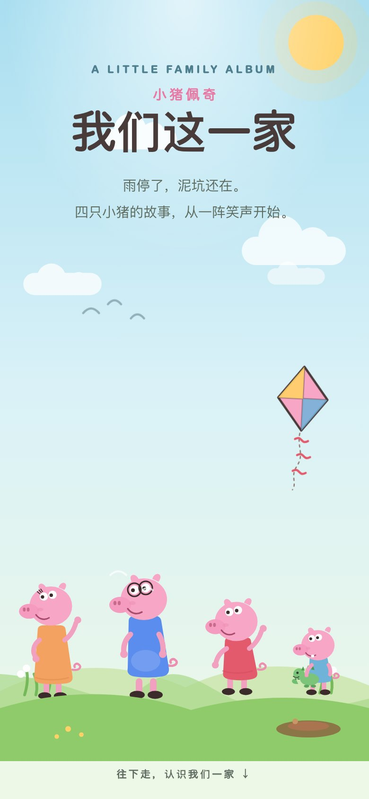
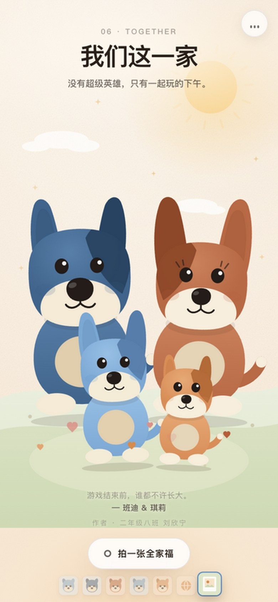

# h5-stash

两个单文件、零外部依赖的 H5 作品，暂存在这里。

| 目录 | 作品 | 首屏 |
|---|---|---|
| [`peppa-family/`](peppa-family/) | 小猪佩奇 · 我们这一家 |  |
| [`bluey-family/`](bluey-family/) | 布鲁伊 · 一家四口（二年级八班 刘欣宁） |  |

## 预览

```bash
cd h5-stash
python3 -m http.server 8000
```

- 佩奇：http://localhost:8000/peppa-family/
- 布鲁伊：http://localhost:8000/bluey-family/

也可以直接双击各目录下的 `index.html`（`file://` 下分享/返回按钮行为可能不完整）。

## 说明

- `peppa-family/`、`bluey-family/` 各自保留了原始 README 与首屏/长图预览。
- 已用 GitHub Actions 发布到 GitHub Pages：https://taotao1101012.github.io/h5-stash/
